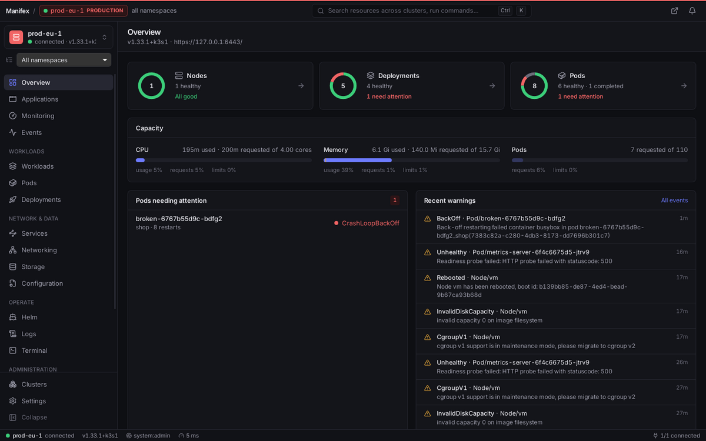
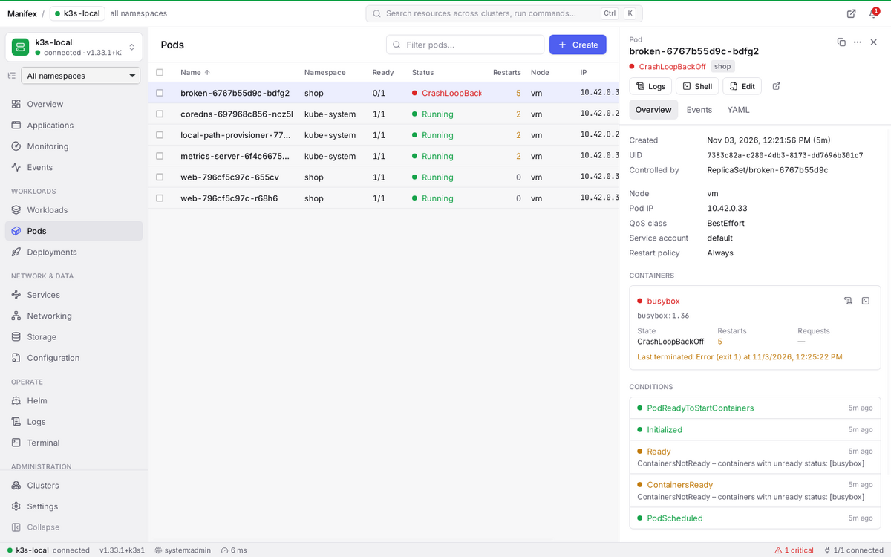
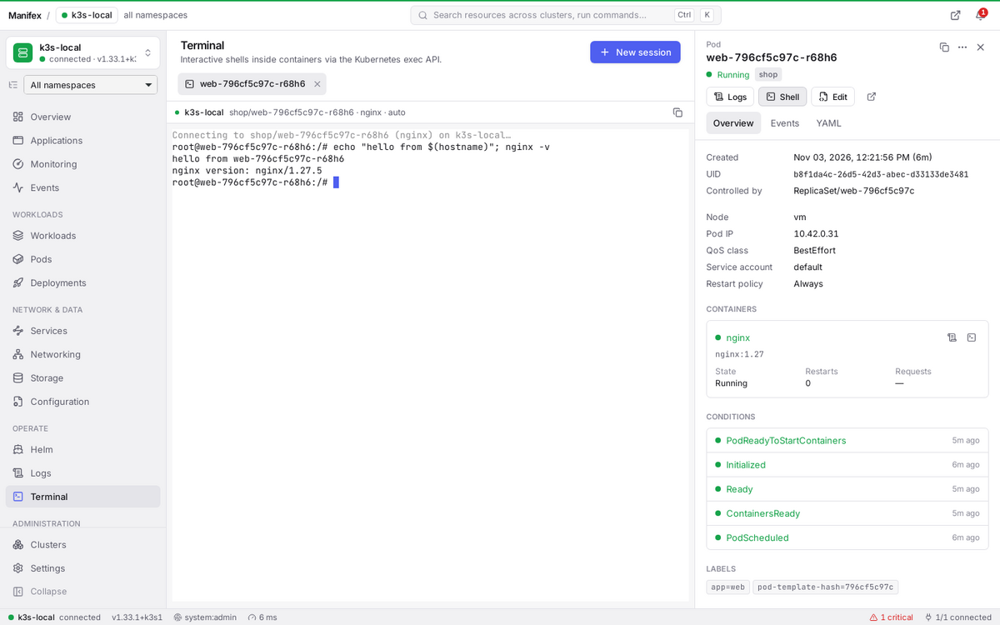
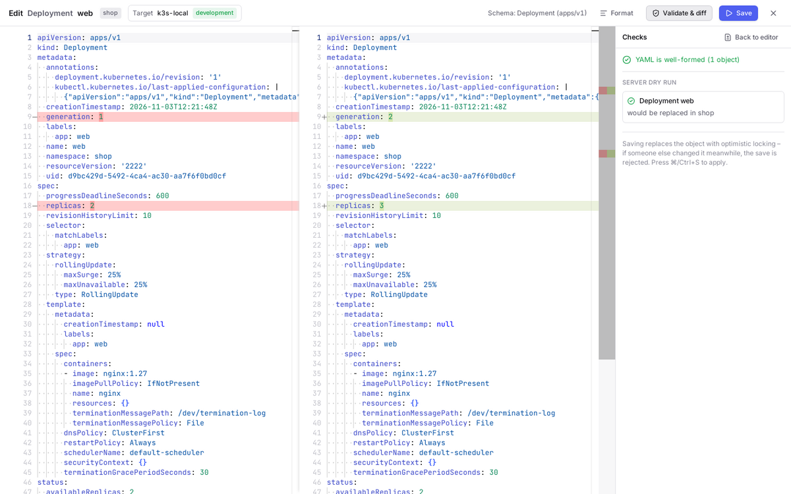
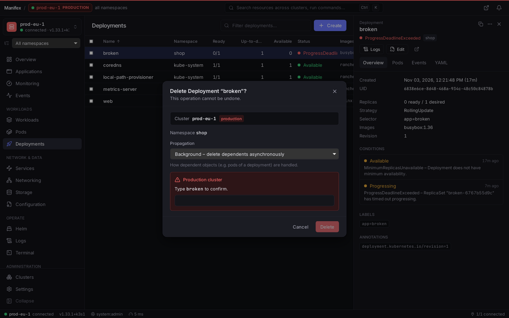

# Manifex

**Manifex** is a native desktop application for managing, observing and operating
Kubernetes clusters – built with Tauri 2, a Rust core and a React/TypeScript
interface. It talks to the real Kubernetes API (watches, server-side apply, exec,
logs, metrics, RBAC) and runs on Windows, macOS and Linux.



## Highlights

- **Multi-cluster** – kubeconfig discovery & import, direct token / client
  certificate connections, **"via SSH server"** (log in with your SSH key /
  OpenSSH certificate / password – Manifex fetches the kubeconfig from the server
  and tunnels the API, nothing to install remotely) and agent-based access to
  private clusters ([`agent/`](agent/)). Favourites, groups, environment tags, per-cluster colours,
  several windows side by side, cross-cluster search and cluster comparison.
- **Wrong-cluster protection** – the active cluster and its environment are always
  visible (title bar stripe, badge, status bar, every confirmation). Destructive
  actions on *production* clusters require typing the object name – enforced in the
  Rust core, not just the UI.
- **Live everything** – shared, cached Kubernetes watches feed virtualised tables
  that stay smooth with tens of thousands of objects.
- **Workloads, networking, storage, configuration, RBAC, CRDs** – Pods,
  Deployments (scale, restart, pause, rollout history & rollback), StatefulSets,
  DaemonSets, Jobs, CronJobs (run now, suspend), HPAs, PDBs, Services, Ingress,
  **Gateway API**, NetworkPolicies, PV/PVC/StorageClasses, ConfigMaps, Secrets,
  ServiceAccounts/Roles/Bindings, nodes (cordon, drain) and every custom resource.
- **YAML editor** – Monaco with completion, hover and validation from the
  *connected cluster's own OpenAPI schema* (including CRDs), formatting, server-side
  dry-run with diff, apply (server-side apply) and safe edits (optimistic locking).
- **Integrated terminal** – interactive container shells via the exec API
  (xterm.js), multiple tabs, container & shell selection, resize, copy.
- **Logs** – streaming, multi-pod (workload) logs, regex filter, timestamps,
  previous container, export.
- **Helm** – releases decoded natively from the cluster (history, values,
  manifest, notes, resources), install/upgrade/rollback/uninstall via the Helm CLI,
  repositories and chart search.
- **Monitoring & alerting** – capacity (requests/limits/usage), live CPU/memory
  charts and top pods (metrics.k8s.io), alerts for pod failures, workload failures,
  node problems and custom rules – with native desktop notifications.
- **Desktop-native** – system tray, native menus (macOS), global shortcut, command
  palette (`Ctrl/⌘ K`), deep links (`manifex://cluster/<id>/pods`), multiple windows,
  dark/light mode, auto-updater, installers for all platforms.
- **Secure by design** – credentials encrypted with a key held by the OS keychain,
  TLS verification always enforced, strict CSP, no shell/fs plugins in the webview,
  validated inputs, RBAC-aware UI and a local audit log of every change.
  See [docs/SECURITY.md](docs/SECURITY.md).

| | |
|---|---|
|  |  |
|  |  |

## Getting started

### Prerequisites

- Node.js 22+, Rust (stable, 1.80+)
- Platform dependencies for Tauri 2:
  - **Linux:** `libwebkit2gtk-4.1-dev libayatana-appindicator3-dev librsvg2-dev libxdo-dev libssl-dev libdbus-1-dev`
  - **macOS:** Xcode command line tools
  - **Windows:** Microsoft C++ Build Tools, WebView2 (preinstalled on Windows 11)
- Optional: Helm 3 CLI (install/upgrade/rollback/uninstall), metrics-server in the
  cluster (live usage metrics)

### Run

```bash
npm install
npm run app:dev        # Tauri dev mode (Vite + Rust, hot reload)
```

### Build installers

```bash
npm run app:build      # .msi/.exe, .dmg/.app, .AppImage/.deb/.rpm in src-tauri/target/release/bundle
```

## Tests

```bash
npm run typecheck && npm test                    # frontend unit tests (vitest)
cd src-tauri && cargo test --lib                 # Rust unit tests
cargo clippy --all-targets -- -D warnings

# End-to-end against a real cluster (creates and deletes a temporary namespace):
MANIFEX_E2E_KUBECONFIG=~/.kube/config cargo test --test cluster_e2e -- --nocapture
```

The e2e suite covers kubeconfig discovery, connection, API discovery, server-side
apply (incl. dry run and strict field validation), live watches, log streaming,
interactive exec, scale/restart/rollout history/rollback, optimistic-lock conflicts
and – when `MANIFEX_E2E_AGENT_*` is set – a connection with exec through
`manifex-agent`. CI runs it against k3s.

## Repository layout

```
src/            React + TypeScript frontend
src-tauri/      Rust core (Tauri 2): commands, desktop shell, Kubernetes layer, persistence, security
agent/          manifex-agent – in-cluster gateway for remote/private clusters
docs/           architecture, security, development phases, release process
.github/        CI (lint, tests, e2e on k3s) and release pipeline
```

## Documentation

- [Architecture](docs/ARCHITECTURE.md)
- [Security model](docs/SECURITY.md)
- [Development phases & verification](docs/PHASES.md)
- [Releases, signing & auto-update](docs/RELEASE.md)

## License

Apache-2.0
